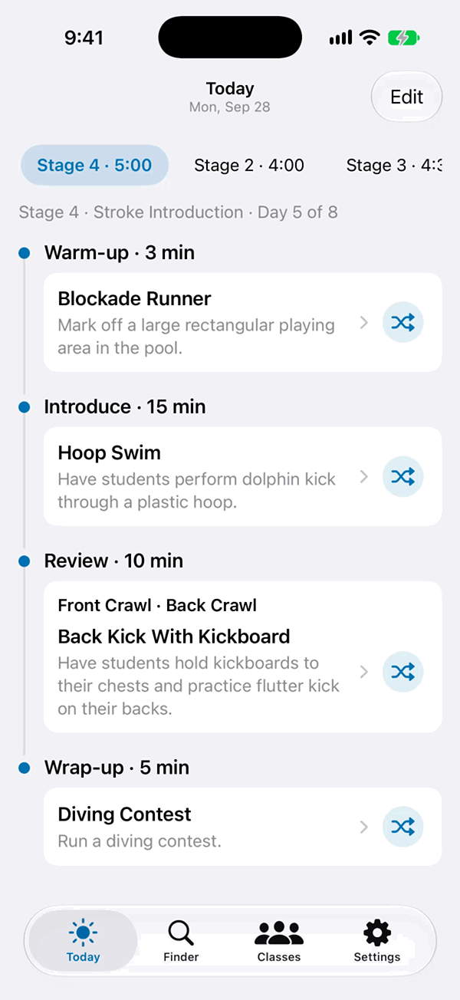
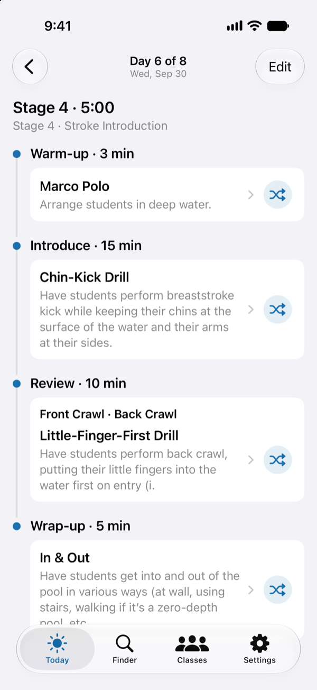
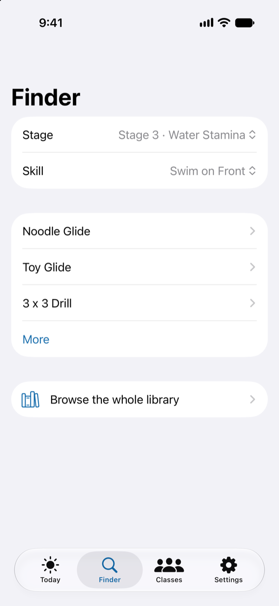
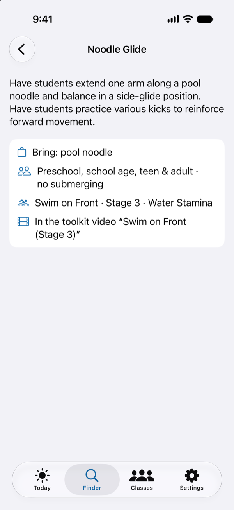
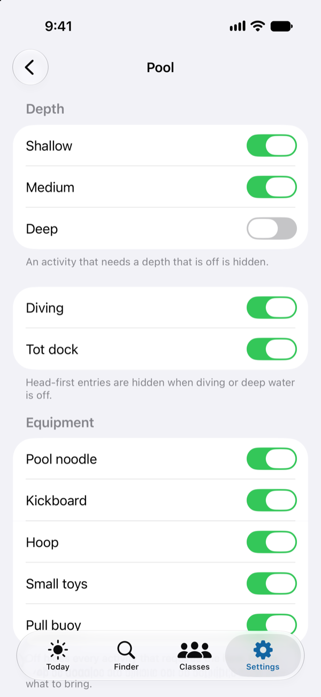

<h1 align="center">DeckPlan</h1>
<p align="center"><em>Find new milestone-specific exercises</em></p>



For any Y instructor who wants to try a new exercise, or has students a previous exercise didn't
work for and needs to try something new. Open it before a shift, or before a class if you have
to. It opens on today's lesson plan.

Before, I repeated the same exercises every week, and if a student had trouble I had to come up with
a new exercise on the spot. This is not a student manager app or a precise calendar app. This app
has one aim: to give instructors new lessons fit for the YMCA structure.

- **Today** — All classes ongoing today, each with swappable cards that contain a shuffled
  list of exercises for each of the class goals, keeping things fresh.
- **Finder** — Get new exercises for a specific stage and skill from the database.
- **Classes** — Add the classes you teach, with the class session dates and stage.
- **Pool** — Adjust your pool settings so only exercises possible at your pool are present.

<br clear="all">

<table align="center">
  <tr>
    <td align="center"></td>
    <td align="center"></td>
    <td align="center"></td>
    <td align="center"></td>
  </tr>
  <tr>
    <td align="center">Today's classes, cards ready to swap</td>
    <td align="center">A stage, a skill, new exercises</td>
    <td align="center">One exercise, in full</td>
    <td align="center">Only what your pool can do</td>
  </tr>
</table>

## Try it

You need Xcode 27 or newer and Python 3 (standard library only).

```bash
python3 tools/dev/sync_resources.py --demo    # bundle the made-up sample curriculum
open DeckPlan.xcodeproj                       # then run the DeckPlan scheme on a simulator
```

Due to copyright rules, this app doesn't contain the parsed data. The YMCA's PDFs are linked
below. Point a coding agent at them and at [docs/CURRICULUM_FORMAT.md](docs/CURRICULUM_FORMAT.md)
and it can cheaply parse them into the JSON the app reads, in `curriculum/`. Then run the
validator, and read each stage against the PDF once before you teach from it.

```bash
python3 tools/core/curriculum.py --validate   # check your transcription
python3 tools/dev/sync_resources.py           # bundle it in place of the sample
```

<details>
<summary>The curriculum, and where the YMCA's PDFs are</summary>

DeckPlan reads the YMCA Swim Lessons V6 curriculum — stages, skills, steps, activities, lesson
guides, topics — from JSON files in `curriculum/`. Those files are a transcription of the YMCA
Swim Lessons Instructor Toolkit, which is **Copyright © 2016 by YMCA of the USA. All rights
reserved.** They are not in this repository, not in any build shared with anyone else, and they
are not covered by this project's licence.

What is here instead is a **made-up sample curriculum** in `examples/`: the same shape, the same
field names, invented content. Every activity, step, topic and safety line in it was written for
this project. The tests run on it, and so does the app in demo mode.

If you are a YMCA instructor with access to the toolkit, you can transcribe your own copy into
`curriculum/` (the format is in [docs/CURRICULUM_FORMAT.md](docs/CURRICULUM_FORMAT.md)). Keep it
to yourself: it is the YMCA's material, not yours or mine.

### Where the source documents are

The toolkit is published to instructors through the **YMCA Swim Lessons Instructor V6** app at
[my.yapp.us/YSLSWIM](https://my.yapp.us/YSLSWIM), whose Toolkit tab links these PDFs, all
© YMCA of the USA:

**The programme as a whole** — what the stages are and how a swimmer moves through them:

- [Program Overview](https://yapp-uploaded-images.s3.amazonaws.com/b3ca30d0915c11e6b3deebc63f32a013/Swim-Lessons-Program-Overview.pdf) — the six stages and the two before them, and who each is for
- [Stage Overview](https://yapp-uploaded-images.s3.amazonaws.com/f84de7a0915d11e68091a57106bce9d0/Swim-Lessons-Stage-Overview.pdf) — each stage's skills and what a swimmer must do to finish it
- Skill Continuum: [infant, toddler and preschool](https://yapp-uploaded-images.s3.amazonaws.com/c7451170915c11e6a8835f8e5f526296/Swim-Lessons-Skill-Continuum-Infant-Toddler-Preschool.pdf) · [school age, teen and adult](https://yapp-uploaded-images.s3.amazonaws.com/d58d12f0915c11e68acecb7c17c9760a/Swim-Lessons-Skill-Continuum-SchoolAge-Teen-Adult.pdf) — every skill across every stage, on one page
- [Progress Tracker](https://yapp-uploaded-images.s3.amazonaws.com/1023b360915d11e6ba490bb6c7c24d87/Swim-Lessons-Progress-Tracker.pdf) — the benchmark rows the app calls tracker rows
- [Toolkit Introduction](https://yapp-uploaded-images.s3.amazonaws.com/99bf7920915c11e6a667d3859bb02d84/Swim-Lessons-Swim-Instructor-Toolkit-Introduction.pdf) · [Session Planner](https://yapp-uploaded-images.s3.amazonaws.com/5ffe49c0915f11e6a93eed17891f415f/Swim-Lessons-Session-Planner.pdf) · [Safety and Character Topics](https://yapp-uploaded-images.s3.amazonaws.com/95213180915f11e68aeabd2b9391a2ef/Swim-Lessons-Safety-and-Character-Topics.pdf) · [Home Activities](https://yapp-uploaded-images.s3.amazonaws.com/ee8c46b0915f11e69022c31b5d168899/Swim-Lessons-Home-Activities.pdf)

**Per stage** — the two documents the app's data comes from:

| Stage | Lesson Guide (the eight sample lessons) | Skill & Topic Library (the activities) |
| --- | --- | --- |
| A | [Lesson Guide A](https://yapp-uploaded-images.s3.amazonaws.com/f08781d0915c11e6a5fcc162ffca585a/Swim-Lessons-Lesson-Guides-STAGEA.pdf) | [Skill & Topic Library A](https://yapp-uploaded-images.s3.amazonaws.com/17190d90915e11e6b72dd92ff42c6c20/Swim-Lessons-Skill-and-Topic-Library-STAGEA.pdf) |
| B | [Lesson Guide B](https://yapp-uploaded-images.s3.amazonaws.com/22e4b9e0915d11e6bf9485dc94d80ea0/Swim-Lessons-Lesson-Guides-STAGEB.pdf) | [Skill & Topic Library B](https://yapp-uploaded-images.s3.amazonaws.com/3c6e8c50915e11e6881ac10b09a912f4/Swim-Lessons-Skill-and-Topic-Library-STAGEB.pdf) |
| 1 | [Lesson Guide 1](https://yapp-uploaded-images.s3.amazonaws.com/3a23f580915d11e6844183dc816357e8/Swim-Lessons-Lesson-Guides-STAGE1.pdf) | [Skill & Topic Library 1](https://yapp-uploaded-images.s3.amazonaws.com/62a85090915e11e6a93eed17891f415f/Swim-Lessons-Skill-and-Topic-Library-STAGE1.pdf) |
| 2 | [Lesson Guide 2](https://yapp-uploaded-images.s3.amazonaws.com/5acc3fe0915d11e6a93eed17891f415f/Swim-Lessons-Lesson-Guides-STAGE2.pdf) | [Skill & Topic Library 2](https://yapp-uploaded-images.s3.amazonaws.com/8c627860bbe411e6834b451578449467/STAGE2-Skill-_-Topic.pdf) |
| 3 | [Lesson Guide 3](https://yapp-uploaded-images.s3.amazonaws.com/7121ded0915d11e68acecb7c17c9760a/Swim-Lessons-Lesson-Guides-STAGE3.pdf) | [Skill & Topic Library 3](https://yapp-uploaded-images.s3.amazonaws.com/9b886760915e11e6ba490bb6c7c24d87/Swim-Lessons-Skill-and-Topic-Library-STAGE3.pdf) |
| 4 | [Lesson Guide 4](https://yapp-uploaded-images.s3.amazonaws.com/8a6b4250915d11e6b7d48106776de8be/Swim-Lessons-Lesson-Guides-STAGE4.pdf) | [Skill & Topic Library 4](https://yapp-uploaded-images.s3.amazonaws.com/cd9842c0915e11e68acecb7c17c9760a/Swim-Lessons-Skill-and-Topic-Library-STAGE4.pdf) |
| 5 | [Lesson Guide 5](https://yapp-uploaded-images.s3.amazonaws.com/a1831fd0915d11e6bf9485dc94d80ea0/Swim-Lessons-Lesson-Guides-STAGE5.pdf) | [Skill & Topic Library 5](https://yapp-uploaded-images.s3.amazonaws.com/e65aea10915e11e69345672c01511565/Swim-Lessons-Skill-and-Topic-Library-STAGE5.pdf) |
| 6 | [Lesson Guide 6](https://yapp-uploaded-images.s3.amazonaws.com/c0f2c320915d11e6a0d6e527fcfa9802/Swim-Lessons-Lesson-Guides-STAGE6.pdf) | [Skill & Topic Library 6](https://yapp-uploaded-images.s3.amazonaws.com/191de8d0915f11e693b45764b44da86e/Swim-Lessons-Skill-and-Topic-Library-STAGE6.pdf) |

Everything in one file: [Complete Toolkit](https://yapp-uploaded-images.s3.amazonaws.com/146dda20bbe411e6919e3dcf28f3e504/Complete-Toolkit-for-app.pdf) (459 pages, 8.8 MB).

</details>

## Under the hood

A Python core is the reference, written first; the Swift port that drives the app has to produce
byte-identical output on every fixture ([docs/CANONICAL_JSON.md](docs/CANONICAL_JSON.md) defines the
encoding and the hash). Plans are deterministic: the same class, day and pool give
the same plan, and Shuffle is a seeded draw, with random seeds in the works. Everything stays on
the phone: no accounts, no network, no analytics. The stack is SwiftUI, a local Swift package and
the Python standard library, with no third-party dependencies.

<details>
<summary>Folders and tests</summary>

| Folder | What is in it |
| --- | --- |
| `tools/core/` | the Python reference core: the pool filter, the day plan, shuffle, the finder, classes, the CLI |
| `DeckPlanCore/` | the Swift port of that core as a local package, with its own tests |
| `DeckPlan/` | the SwiftUI app; only `AppModel*.swift` talks to the core |
| `examples/` | the made-up sample curriculum and the fixtures both cores are held to |
| `tests/`, `DeckPlanCore/Tests/`, `DeckPlanTests/` | the three test suites |
| `docs/` | how the curriculum is encoded, the canonical JSON and hash, and the test list |

Comments in the code cite the project's design notes by name and section (SPEC, PLANNER,
REDESIGN, the decisions log). Those notes are kept private; the code and the tests are the reference.

```bash
python3 -m unittest discover -s tests                      # the Python reference core
(cd DeckPlanCore && swift test)                            # the Swift port
python3 tools/dev/sync_resources.py --demo                 # the app, on the made-up sample
python3 tools/dev/xcode_sources.py --check
xcodebuild -project DeckPlan.xcodeproj -scheme DeckPlan \
  -destination 'platform=iOS Simulator,name=iPhone 17 Pro' test
```

</details>

## Licence

The code is licensed under [PolyForm Noncommercial 1.0.0](LICENSE): free for personal use and
for any nonprofit organisation (a YMCA included), not for selling. The licence covers this
project's own code and the made-up sample data. It cannot and does not grant any right to the
YMCA curriculum described above.

## Not affiliated

DeckPlan is a personal project by a swim instructor. It is not affiliated with, endorsed by or
sponsored by YMCA of the USA or any YMCA association, and "YMCA" is their trademark.
